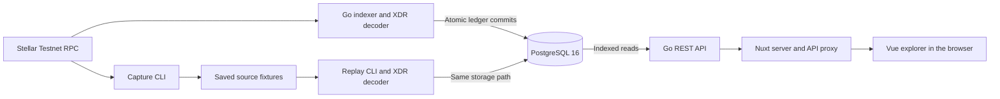

# Architecture

Crouton Stellar Explorer is a read-only Stellar **Testnet** explorer. A Go indexer reads one configured Stellar RPC endpoint, decodes complete ledgers and stores them in PostgreSQL. A separate Go API serves indexed data through a Nuxt 4 / Vue 3 frontend. Reading explorer pages does not require an RPC request.

This document describes the implemented system through **migration 13**, with transaction interpretation version **5**. The [database reference](database.md) lists all 17 tables, their columns, constraints and indexes. The executable schema is maintained in [SQL migrations](../migrations/migrations.go); API contracts are in [OpenAPI](openapi.json).

The [UI guide](ui-guide.md) describes screen locations, visible panels and user controls.

## Runtime components

The arrows below show data flow. The browser sends same-origin requests to Nuxt, which proxies `/api/v1` to the Go API.



| Component     | Responsibility                                                                 | Local Compose endpoint                                         |
| ------------- | ------------------------------------------------------------------------------ | -------------------------------------------------------------- |
| `indexer`     | Network verification, RPC polling, decoding and atomic persistence             | No published port                                              |
| `api`         | Entity/history endpoints, search, activity statistics, health and OpenAPI      | `127.0.0.1:8080`                                               |
| `web`         | Server rendering, same-origin API proxy and interactive Vue pages              | `127.0.0.1:3000`                                               |
| `db`          | Source history, derived indexes, migration state and ingestion progress        | `127.0.0.1:${POSTGRES_PORT:-5432}`; internal address `db:5432` |
| `capture` CLI | Downloads public source examples to fixture files                              | Uses the configured RPC; no database writes                    |
| `replay` CLI  | Imports saved complete-ledger fixtures through the regular decoder and storage | Uses a database; no RPC requests                               |

Compose keeps PostgreSQL data in the `postgres-data` volume. `NUXT_API_BASE` configures the server-side API destination (`http://api:8080` in Compose). RPC configuration belongs to the backend. No signing keys or wallet connection are needed. See the [startup guide](run.md) for configuration and commands.

## Source layout

| Path                                               | Responsibility                                                                       |
| -------------------------------------------------- | ------------------------------------------------------------------------------------ |
| `cmd/api`, `cmd/indexer`                           | Service entry points and shutdown handling                                           |
| `cmd/capture`, `cmd/replay`                        | Source fixture capture and offline import                                            |
| `internal/app`, `internal/config`                  | Shared startup, configuration validation, database opening and migrations            |
| `internal/stellar`                                 | Bounded JSON-RPC client for `getNetwork`, `getHealth` and `getLedgers`               |
| `internal/ingestion`                               | Polling, bootstrap/resume decisions, continuity and retry policy                     |
| `internal/decoder`                                 | XDR decoding, typed values, events, movements, interpretations and protocol adapters |
| `internal/domain`                                  | Shared ledger, transaction, evidence, filter and API response models                 |
| `internal/storage`                                 | PostgreSQL writes, enrichment hooks, queries, snapshots and cursors                  |
| `internal/httpapi`                                 | Routes, validation, pagination, request context and JSON errors                      |
| `migrations`                                       | Embedded SQL migrations 1–13                                                         |
| `web/app`                                          | Pages, reusable controls, search palette, charts and styling                         |
| `web/server/api/v1`                                | Server-side API proxy                                                                |
| `docs`                                             | Public documentation and embedded OpenAPI specification                              |
| `tests/fixtures`, `internal/testutil`, `web/tests` | Source fixtures, test builders, unit and browser checks                              |
| `deploy`, `.github/workflows`                      | Container builds and continuous integration                                          |

## Ingestion and atomic writes

1. The indexer calls `getNetwork` and requires the Testnet passphrase. It obtains the provider's current oldest/latest ledger range from `getHealth` and records the successful tip observation independently of ledger commits.
2. A saved checkpoint takes precedence over `START_LEDGER`. With an empty database and `START_LEDGER=0`, ingestion starts at `max(oldest, latest-100)`. Subsequent imports start at `last_completed_ledger + 1`.
3. `getLedgers` returns source metadata. The decoder reads `LedgerCloseMeta`, validates the reported sequence/hash, matches envelopes to result metadata by network-specific transaction hash and preserves metadata application order. Transaction indexes are one-based; operation and event indexes are zero-based.
4. The complete ledger is decoded before persistence. Unsupported but readable values retain an explicit fallback and source XDR; structurally invalid source data prevents the ledger from committing.
5. `Store.Save` starts one database transaction and acquires advisory lock `834502`. An existing sequence with the same hash is a no-op. A conflicting hash, a nonconsecutive new ledger or a previous-hash mismatch is rejected.
6. The transaction writes the ledger, full transactions, operation/call/event projections, fee events, fungible/NFT activity, observed contracts and participant relations.
7. The same transaction advances `indexer_checkpoints` and increments `processed_transactions`. A failed child write rolls back the entire ledger and its progress updates.
8. Commit makes the ledger and all its children visible together. The indexer then proceeds to the next ledger.

```mermaid
sequenceDiagram
    participant I as Indexer
    participant R as Stellar RPC
    participant D as Decoder
    participant S as Store
    participant P as PostgreSQL
    I->>R: getNetwork and getHealth
    I->>S: Record tip observation and read checkpoint
    I->>R: getLedgers from next sequence
    R-->>I: Source LedgerCloseMeta
    I->>D: Decode complete ledger
    D-->>I: Validated ledger bundle
    I->>S: Save bundle
    S->>P: BEGIN and ingestion advisory lock
    S->>P: Validate replay and chain continuity
    S->>P: Write source, projections and relations
    S->>P: Advance checkpoint and transaction counter
    alt Every write succeeds
        S->>P: COMMIT
        S-->>I: Ledger committed
    else Validation or write fails
        S->>P: ROLLBACK
        S-->>I: Error; checkpoint unchanged
    end
```

RPC and nonfatal processing/storage failures are retried with exponential backoff capped by `RETRY_MAX`. Wrong-network responses, unavailable required history, an invalid start/checkpoint or storage continuity violations stop the indexer. It does not skip missing ledgers. SIGINT/SIGTERM cancel work; the API drains requests during shutdown.

The indexer uses one RPC endpoint; a second node is not part of the current architecture. Historical archive download and arbitrary insertion before the existing first ledger are not implemented. The replay command follows the same continuity rules. Migration helpers named `backfill...` enrich already stored data; they do not retrieve older network history.

## Database model

PostgreSQL combines retained source XDR, JSONB response payloads and normalized lookup tables. There are no separate account-state, NFT-owner, swap or state-change tables. Account history is a participant relation; swap interpretations and state changes live inside the transaction payload. NFT item views and activity statistics are computed from indexed rows.

| Group                           | Tables                                                                           |
| ------------------------------- | -------------------------------------------------------------------------------- |
| Schema and ingestion state      | `schema_migrations`, `indexer_metadata`, `indexer_checkpoints`, `indexer_status` |
| Ledger and transaction history  | `ledgers`, `transactions`, `operations`, `contract_calls`, `contract_events`     |
| Participant and contract lookup | `transaction_accounts`, `contracts`, `transaction_contracts`                     |
| Fungible token activity         | `assets`, `token_transfers`                                                      |
| Fee evidence                    | `fee_events`                                                                     |
| NFT event activity              | `nft_collections`, `nft_transfers`                                               |

Every history key includes `network`. The implementation accepts Testnet only; network-qualified keys do not imply Mainnet support. The database enforces ledger/transaction identities, event provenance links and numeric bounds where declared. The decoder/storage layer additionally checks source identity, application semantics and evidence consistency. See the [ER diagram and full schema](database.md) for the exact foreign keys; matching address strings do not automatically create database relations.

## Decoding and evidence

| Feature                              | Implemented evidence and storage                                                                                                                                                                            |
| ------------------------------------ | ----------------------------------------------------------------------------------------------------------------------------------------------------------------------------------------------------------- |
| Classic operations and Soroban calls | Operation projections, top-level `invokeContract` calls, typed arguments and available returns/diagnostics; full transaction payload retains the source representation                                      |
| Fungible movements                   | Committed SEP-41-compatible transfers/burns and verified SAC mint/clawback events in `assets` / `token_transfers`; amounts and provenance remain explicit                                                   |
| Fees and refunds                     | CAP-67 transaction events and normalized `fee_events`, including failed transactions; a complete fee summary must reconcile with `TransactionResult.feeCharged`                                             |
| Transaction interpretation           | Versioned actions, result-based failure explanations, classic path-payment swaps and before/after state projections in `transactions.payload.interpretation`                                                |
| Soroswap / Aquarius                  | Registered Testnet router adapters reconcile typed requests, successful result commitments and committed event/transfer evidence; Aquarius also supports bounded strict-receive settlement and split routes |
| NFT history                          | Supported unsigned scalar/map token IDs and committed transfer/mint/burn evidence in separate NFT tables; event-shape recognition does not certify a collection                                             |
| Contract metadata                    | Observed instance/call/event/token evidence in `contracts` with transaction links; executable updates follow ledger and transaction application order                                                       |

Large integer quantities and NFT IDs are exposed as exact strings. Unknown decimals, absent code identity and missing creation evidence remain unknown. Failed operation attempts do not become applied token/NFT movements; transaction-level fee evidence is handled separately. Diagnostic errors never override execution status.

Adapters retain generic calls/movements when evidence is unsupported or ambiguous. There is no complete internal Soroban call tree. Aquarius pool addresses are matched from events/transfers rather than independently registry-verified, and an observed WASM hash is not an audit claim. Detailed boundaries are documented in [interpretation](interpretation.md), [standards and fees](standards.md), [tokens](tokens.md), [NFTs](nfts.md) and [contracts](contracts.md).

## API reads, pagination and snapshots

The API exposes overview, ledger/transaction details and histories, account/contract activity, fungible assets/movements, NFT collections/items/movements, events, search and bounded activity statistics. Responses are backed by indexed data; a missing entity does not prove absence on the network. The [OpenAPI specification](openapi.json) defines the routes and response fields.

Transaction detail reads the full stored payload. Transaction lists remove raw XDR, operations, events, diagnostics, movement arrays, contract observations and interpretation to keep list responses smaller. Normalized tables support filtering without scanning each full transaction payload. Some fields, such as contract creation metadata, remain in JSONB rather than separate SQL columns.

Cursors are Base64URL-encoded JSON containing a version, dataset ID, query kind, scope, snapshot ledger, last sort key and normalized filters. They are not authentication tokens. The storage layer rejects another dataset/query/filter set or a future snapshot. Page limits default to `min(20, API_MAX_LIMIT)` and may not exceed the configured maximum.

| List                   | Descending order                                              |
| ---------------------- | ------------------------------------------------------------- |
| Ledgers                | `sequence`                                                    |
| Transactions           | `ledger_sequence`, `tx_index`                                 |
| Events                 | `ledger_sequence`, `transaction_hash`, `event_index`          |
| Fungible/NFT movements | `ledger_sequence`, `tx_index`, `event_index`                  |
| Assets                 | `first_ledger`, `contract_id`                                 |
| NFT collections        | First observed ledger within the snapshot, then `contract_id` |

The first page captures the indexed checkpoint and later pages remain bounded by it. This is a ledger-range snapshot, not a database transaction held across browser requests: it does not freeze every mutable aggregate metadata payload. NFT detail counts and movement pages explicitly share `snapshot_ledger`, including protection against the first-ledger ingestion race. Ordinary composite responses can perform several reads while ingestion advances.

### Search and activity charts

Exact search resolves complete transaction hashes, G/C addresses and ledger numbers. Live suggestions accept ledger prefixes or at least four hash/address characters, using C-collation identifier indexes and bounded numeric ledger ranges. They return at most five matches per type / ten total and deduplicate account observations. Suggestions use a read-only repeatable-read transaction. The UI provides a compact centered search dialog with a blurred backdrop, debounce, cancellation, keyboard navigation and explicit error states. See [search](search.md).

Activity queries use read-only repeatable-read transactions and the same applicable filters/list cursor. Each request considers at most 120 actual indexed ledger rows, grouped into buckets of up to ten rows, including zero-count buckets. Overview/list charts show counts and outcomes or movement kinds; account/contract line charts apply entity filters and end at the newest transaction on the current page. These series do not establish balances, token volumes, prices or complete network throughput. See [activity statistics](activity.md).

## Migrations and retained-history upgrades

API and indexer startup open PostgreSQL and apply embedded migrations before serving or ingesting. The replay command also migrates before importing. `Store.Migrate` applies pending migrations and their Go enrichment hooks in one database transaction under advisory lock `834501`. Migrations that rebuild retained data also take ingestion lock `834502` to coordinate with ledger writes.

Schema version and interpretation version have separate meanings: migration **13** adds search indexes, while the current transaction interpretation remains version **5**. Migrations 8–11 primarily trigger interpretation rebuilds rather than add swap/state tables. The [migration map](database.md#migration-map) lists all versions and hooks.

Retained-history enrichment uses saved source evidence and preserves the existing dataset/checkpoint. Corrupt or conflicting source data aborts the upgrade. API readiness becomes available only after startup migration commits. Compose allows a ten-minute health-check startup period for upgrades; the actual work depends on retained data size.

## Operations and current boundaries

Each Go process uses a PostgreSQL pool of at most ten connections with a five-second connect timeout. The RPC client has a 30-second HTTP timeout and a 64 MiB response limit. API requests receive a ten-second context deadline; the HTTP server also configures header/read/write/idle timeouts. Queries use parameters, and API errors have a consistent JSON envelope, a request ID and no raw database error text.

HTTP data access supports GET/HEAD. The API process still needs migration/write privileges at startup; read-only endpoints are not a separate database-role security boundary. Nuxt keeps the backend destination server-side and exposes a same-origin proxy. Compose publishes ports on loopback by default.

`/health/live` checks the process; `/health/ready` checks PostgreSQL. Neither proves RPC availability or synchronization. `indexer_status` stores the last successful tip observation, latest error and cumulative counters. `indexer_checkpoints` stores committed coverage. JSON logs include ledger/error context. Prometheus metrics, API keys, rate limiting, automatic backup/restore and a production SLA are not implemented.

RPC outages do not prevent serving previously committed history. After a Testnet reset or a history gap, an operator must explicitly choose a new dataset/database or another supported source; existing history is not deleted or mixed automatically. Live balances, NFT ownership/artwork/metadata, historical archive backfill and Mainnet remain outside the implemented scope.

CI runs Go race/integration tests, formatting, vet/build, frontend unit/type/format/build checks, fixture-backed desktop/mobile browser tests and Compose validation. Verification commands and evidence boundaries are in [testing](../tests/README.md). Deployment instructions are in [run](run.md).
