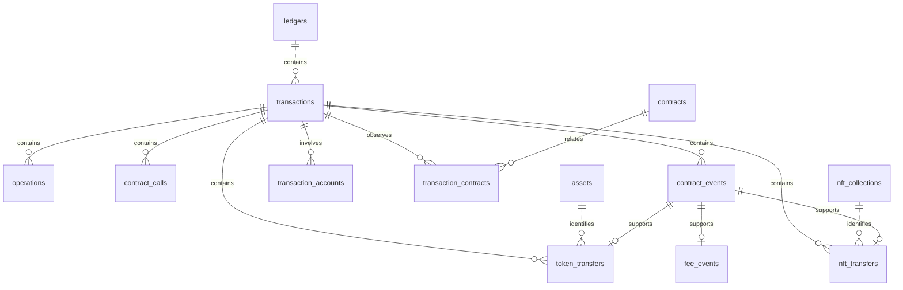

# Database schema

The explorer uses PostgreSQL 16. This reference describes **migrations 1–13**: **17 tables** and **21 explicitly declared secondary indexes**, in addition to primary-key and unique-constraint indexes. SQL definitions are embedded by [migrations.go](../migrations/migrations.go), and [Store.Migrate](../internal/storage/store.go) applies them together with Go enrichment hooks. See [architecture](architecture.md) for runtime and ingestion flows.

All columns below are **NOT NULL** unless marked nullable. PostgreSQL types are shown using SQL aliases (`integer`, `bigint`, `timestamptz`, `numeric`). JSON fields can contain JSON `null` even when the containing SQL column is NOT NULL.

## Relationships

The ER diagram shows the **declared foreign keys**. Every history relationship includes `network`; the compact diagram omits column details, which are listed below. The four administrative tables are independent of this graph.



There is no foreign key from `contract_calls.contract_id`, `contract_events.contract_id`, `assets.contract_id` or `nft_collections.contract_id` to `contracts`. Movement ledger/operation indexes are not separate foreign keys to `ledgers` / `operations`. Their consistency is checked by the decoder/storage path. Foreign keys use the default delete behavior; no cascade deletion is declared.

## Administrative tables

### `schema_migrations`

One row per applied migration. Its version is independent of transaction interpretation version.

| Column    | Type    | Meaning                               |
| --------- | ------- | ------------------------------------- |
| `version` | integer | Applied migration number; primary key |

### `indexer_metadata`

Identifies a database dataset for cursor validation. Initialization creates the Testnet row.

| Column       | Type | Meaning                                                           |
| ------------ | ---- | ----------------------------------------------------------------- |
| `network`    | text | Primary key                                                       |
| `dataset_id` | text | Default `gen_random_uuid()::text`; copied into pagination cursors |

### `indexer_checkpoints`

One committed contiguous range per network. These values change in the same transaction as ledger writes.

| Column                  | Type        | Meaning                                                       |
| ----------------------- | ----------- | ------------------------------------------------------------- |
| `network`               | text        | Primary key                                                   |
| `first_ledger`          | bigint      | First committed ledger; retained when the checkpoint advances |
| `last_completed_ledger` | bigint      | Last fully committed ledger                                   |
| `updated_at`            | timestamptz | Checkpoint update time; default `now()`                       |

There is no checkpoint-to-ledger foreign key. `Store.Save` enforces sequential progress and previous-hash continuity under the ingestion lock.

### `indexer_status`

Combines RPC observations with processing counters. Tip observations/error updates can happen independently of ledger commits; processed transaction increments are part of ledger commits.

| Column                   | Type        | Meaning                                                                      |
| ------------------------ | ----------- | ---------------------------------------------------------------------------- |
| `network`                | text        | Primary key                                                                  |
| `latest_network_ledger`  | bigint      | Nullable; most recent successfully observed RPC tip                          |
| `observed_at`            | timestamptz | Nullable; time of that successful observation                                |
| `last_error`             | text        | Nullable; latest reported indexing error; a successful observation clears it |
| `processed_transactions` | bigint      | Cumulative committed transaction count; default `0`                          |
| `error_count`            | bigint      | Cumulative recorded indexing errors; default `0`                             |

`lag` is computed from the observed tip and committed checkpoint, not stored. An absent observation remains unknown. The schema does not contain an API request-metrics table.

## Core history tables

### `ledgers`

| Column             | Type        | Meaning                                                                                 |
| ------------------ | ----------- | --------------------------------------------------------------------------------------- |
| `network`          | text        | Must equal `testnet`                                                                    |
| `sequence`         | bigint      | Positive ledger sequence                                                                |
| `hash`             | text        | Ledger hash                                                                             |
| `closed_at`        | timestamptz | Ledger close time                                                                       |
| `protocol_version` | integer     | Protocol version from metadata                                                          |
| `raw_ref`          | text        | Actual Base64 `LedgerCloseMeta` XDR, despite the column name; not an external URI       |
| `payload`          | jsonb       | Serialized ledger model without `raw_xdr`; includes previous hash and transaction count |

Primary key: `(network, sequence)`. Unique constraint: `(network, hash)`. Ledger API responses read `payload`; retained ledger XDR remains in `raw_ref`.

### `transactions`

| Column                   | Type           | Meaning                                                                                |
| ------------------------ | -------------- | -------------------------------------------------------------------------------------- |
| `network`                | text           | Parent ledger network                                                                  |
| `hash`                   | text           | Network-specific transaction envelope hash                                             |
| `ledger_sequence`        | bigint         | Parent ledger sequence                                                                 |
| `tx_index`               | integer        | One-based metadata application order within the ledger                                 |
| `source_account`         | text           | Transaction source account                                                             |
| `successful`             | boolean        | Execution success from the result                                                      |
| `fee_charged`            | numeric(20, 0) | `TransactionResult.feeCharged`, in stroops                                             |
| `created_at`             | timestamptz    | Parent ledger close time                                                               |
| `envelope_xdr`           | text           | Original Base64 transaction envelope                                                   |
| `result_xdr`             | text           | Original Base64 transaction result                                                     |
| `meta_xdr`               | text           | Original Base64 transaction metadata                                                   |
| `payload`                | jsonb          | Full serialized transaction, including source XDR, derived evidence and interpretation |
| `interpretation_version` | integer        | Nonnegative interpretation version; default `0`, current decoder version `5`           |

Primary key: `(network, hash)`. Unique constraint: `(network, ledger_sequence, tx_index)`. Foreign key: `(network, ledger_sequence)` → `ledgers(network, sequence)`.

The normalized XDR columns and the XDR fields in `payload` intentionally overlap. Enrichment code checks source consistency before rebuilding interpretations/NFT data. Fee summaries, returns, diagnostics, participants, swaps and state changes are JSON fields rather than additional transaction columns.

### `operations`

| Column             | Type    | Meaning                                                                                             |
| ------------------ | ------- | --------------------------------------------------------------------------------------------------- |
| `network`          | text    | Parent transaction network                                                                          |
| `transaction_hash` | text    | Parent transaction hash                                                                             |
| `op_index`         | integer | Zero-based operation index                                                                          |
| `type`             | text    | XDR operation type name                                                                             |
| `source_account`   | text    | Effective operation source                                                                          |
| `details_json`     | jsonb   | Complete serialized operation model, including decoded details, decode status and raw operation XDR |

Primary key: `(network, transaction_hash, op_index)`. Foreign key: `(network, transaction_hash)` → `transactions(network, hash)`.

### `contract_calls`

| Column             | Type    | Meaning                               |
| ------------------ | ------- | ------------------------------------- |
| `network`          | text    | Parent transaction network            |
| `transaction_hash` | text    | Parent transaction hash               |
| `op_index`         | integer | Zero-based invocation operation index |
| `contract_id`      | text    | Observed invocation target            |
| `function_name`    | text    | Invoked top-level function            |
| `arguments_json`   | jsonb   | Typed argument array                  |
| `decode_status`    | text    | Decoder status                        |

Primary key: `(network, transaction_hash, op_index)`. Foreign key: `(network, transaction_hash)` → `transactions(network, hash)`. This is a top-level call projection, not an internal call tree; there is no declared foreign key to `operations` or `contracts`.

### `contract_events`

The historical name covers committed operation events and transaction-level events, including fees/refunds.

| Column             | Type    | Meaning                                                               |
| ------------------ | ------- | --------------------------------------------------------------------- |
| `network`          | text    | Parent transaction network                                            |
| `transaction_hash` | text    | Parent transaction hash                                               |
| `event_index`      | integer | Stable zero-based event identifier within the transaction             |
| `ledger_sequence`  | bigint  | Ledger used for filtering/order                                       |
| `contract_id`      | text    | Event emitter; an empty string can represent absent contract identity |
| `event_type`       | text    | XDR contract/system/diagnostic event type name                        |
| `topics_json`      | jsonb   | Typed topic array                                                     |
| `value_json`       | jsonb   | Typed event value                                                     |
| `raw_xdr`          | text    | Base64 source event                                                   |
| `payload`          | jsonb   | Complete event model, including nullable operation index and stage    |
| `event_scope`      | text    | `operation` or `transaction`; default `operation`                     |

Primary key: `(network, transaction_hash, event_index)`. Foreign key: `(network, transaction_hash)` → `transactions(network, hash)`.

Operation provenance (`op_index`) and transaction application stage (`stage`) are JSON fields, not dedicated columns. Transaction events are appended after operation event identifiers to preserve existing keys. Event-index or hash ordering must not be interpreted as execution chronology across a ledger. Diagnostic traces are also retained in the transaction payload and do not establish committed movements.

## Participants and observed contracts

### `transaction_accounts`

| Column             | Type | Meaning                             |
| ------------------ | ---- | ----------------------------------- |
| `network`          | text | Parent transaction network          |
| `address`          | text | Indexed participant account address |
| `transaction_hash` | text | Related transaction                 |

Primary key: `(network, address, transaction_hash)`. Foreign key: `(network, transaction_hash)` → `transactions(network, hash)`.

This relation supports account history/existence/search; there is no `accounts` table. Participants include transaction/fee/operation sources, supported classic destinations and recognized token/NFT participants. It is not a complete classic effects index. NFT contract-address participants remain available through movement queries; this account relation adds valid G-address NFT participants.

### `contracts`

| Column        | Type  | Meaning                         |
| ------------- | ----- | ------------------------------- |
| `network`     | text  | Observation network             |
| `contract_id` | text  | Observed C-address              |
| `payload`     | jsonb | Aggregated contract observation |

Primary key: `(network, contract_id)`. The JSON model holds kind, nullable WASM hash/executable provenance, first/last observed ledgers and nullable creation ledger/transaction/creator. First observation is not proof of creation. These are observations from indexed transactions, not a live contract-state cache.

### `transaction_contracts`

| Column             | Type | Meaning             |
| ------------------ | ---- | ------------------- |
| `network`          | text | Shared network      |
| `contract_id`      | text | Observed contract   |
| `transaction_hash` | text | Related transaction |

Primary key: `(network, contract_id, transaction_hash)`. Foreign keys: `(network, contract_id)` → `contracts(network, contract_id)` and `(network, transaction_hash)` → `transactions(network, hash)`.

This relation includes supported contract observations beyond direct calls, including creation metadata. It is the basis for contract transaction history.

## Fungible token activity

### `assets`

| Column         | Type   | Meaning                                                                        |
| -------------- | ------ | ------------------------------------------------------------------------------ |
| `network`      | text   | Asset network                                                                  |
| `contract_id`  | text   | Token contract identifier                                                      |
| `kind`         | text   | `sac` or `contract`                                                            |
| `first_ledger` | bigint | First observed ledger                                                          |
| `payload`      | jsonb  | Asset model with verification, classic asset/code/issuer and nullable decimals |

Primary key: `(network, contract_id)`. Assets describe observed token identities; they do not store balances, prices or supply. Stronger SAC evidence is retained when observations merge.

### `token_transfers`

| Column             | Type           | Meaning                                                                           |
| ------------------ | -------------- | --------------------------------------------------------------------------------- |
| `network`          | text           | Shared transaction/asset/event network                                            |
| `transaction_hash` | text           | Parent transaction                                                                |
| `event_index`      | integer        | Parent committed operation event                                                  |
| `ledger_sequence`  | bigint         | Indexed ledger                                                                    |
| `tx_index`         | integer        | Transaction application index                                                     |
| `op_index`         | integer        | Source operation index                                                            |
| `contract_id`      | text           | Asset contract                                                                    |
| `kind`             | text           | `transfer`, `mint`, `burn` or `clawback`                                          |
| `from_address`     | text           | Sender, or empty string when absent                                               |
| `to_address`       | text           | Recipient, or empty string when absent                                            |
| `amount`           | numeric(39, 0) | Nonnegative base-unit amount                                                      |
| `payload`          | jsonb          | Complete movement with embedded asset evidence, time and optional muxed recipient |

Primary key: `(network, transaction_hash, event_index)`. Foreign keys reference `transactions(network, hash)`, `assets(network, contract_id)` and `contract_events(network, transaction_hash, event_index)`.

SQL checks require a supported kind and nonnegative amount; typed amount/evidence validation is performed by the decoder. One source event can have at most one fungible movement row. The table does not duplicate classic payment operations as synthetic token events or swap settlement totals as additional movements.

## Fee evidence

### `fee_events`

| Column             | Type           | Meaning                                     |
| ------------------ | -------------- | ------------------------------------------- |
| `network`          | text           | Parent event network                        |
| `transaction_hash` | text           | Transaction being charged/refunded          |
| `event_index`      | integer        | Parent transaction-level fee event          |
| `account`          | text           | Fee payer                                   |
| `amount`           | numeric(39, 0) | Signed fee-event amount in stroops          |
| `stage`            | text           | Application stage from transaction metadata |
| `payload`          | jsonb          | Complete normalized fee event               |

Primary key and foreign key: `(network, transaction_hash, event_index)` → `contract_events(network, transaction_hash, event_index)`. The parent event supplies the transaction foreign key transitively; there is no additional direct fee-to-transaction foreign key.

Fee events can exist for failed transactions. Charge/refund/net reconciliation and completeness status live in `transactions.payload.fees`; missing/inconsistent evidence remains unknown. Signed fee amounts are separate from nonnegative fungible transfer amounts.

## NFT event activity

### `nft_collections`

| Column         | Type   | Meaning                                                 |
| -------------- | ------ | ------------------------------------------------------- |
| `network`      | text   | Observation network                                     |
| `contract_id`  | text   | Observed NFT event emitter                              |
| `first_ledger` | bigint | Positive first observed ledger                          |
| `payload`      | jsonb  | Collection observation with `verification: event_shape` |

Primary key: `(network, contract_id)`. Collection counts are computed from `nft_transfers` within the requested snapshot, rather than stored as mutable supply/ownership counters.

### `nft_transfers`

| Column             | Type           | Meaning                                                                      |
| ------------------ | -------------- | ---------------------------------------------------------------------------- |
| `network`          | text           | Shared transaction/collection/event network                                  |
| `transaction_hash` | text           | Parent transaction                                                           |
| `event_index`      | integer        | Nonnegative source event index                                               |
| `ledger_sequence`  | bigint         | Positive source ledger sequence                                              |
| `tx_index`         | integer        | Positive transaction application index                                       |
| `op_index`         | integer        | Nonnegative operation index                                                  |
| `contract_id`      | text           | Collection emitter                                                           |
| `token_id`         | numeric(78, 0) | Unsigned collection-scoped identifier, constrained to `0` through `2^256-1`  |
| `token_id_type`    | text           | Original `u32`, `u64`, `u128` or `u256` type                                 |
| `kind`             | text           | `transfer`, `mint` or `burn`                                                 |
| `from_address`     | text           | Sender, or empty string when absent                                          |
| `to_address`       | text           | Recipient, or empty string when absent                                       |
| `payload`          | jsonb          | Full evidence, exact string ID, event standard/format, participants and time |

Primary key: `(network, transaction_hash, event_index)`. Foreign keys reference `transactions(network, hash)`, `nft_collections(network, contract_id)` and `contract_events(network, transaction_hash, event_index)`.

Storage rebuilds NFT activity from source and verifies the exact parent operation event before inserting it. The SQL enum/range checks do not independently prove event-shape, type-width or deployed-code compliance. NFT IDs are distinct from fungible amounts. There is no NFT item/owner table: item history and observed counts are derived by `(network, contract_id, token_id)`, bounded by `snapshot_ledger`.

## Secondary indexes

Primary keys and the two explicit unique constraints create their own indexes. The 21 additional indexes below are declared in migrations. `DESC` is part of the indexed key order; columns without an order use ascending order.

| Index                      | Table                  | Indexed keys / predicate                                                                                                                                          | Purpose                               |
| -------------------------- | ---------------------- | ----------------------------------------------------------------------------------------------------------------------------------------------------------------- | ------------------------------------- |
| `transactions_order`       | `transactions`         | `network, ledger_sequence DESC, tx_index DESC`                                                                                                                    | Transaction pagination                |
| `transactions_source`      | `transactions`         | `network, source_account, ledger_sequence DESC`                                                                                                                   | Transaction source lookup             |
| `calls_contract`           | `contract_calls`       | `network, contract_id`                                                                                                                                            | Invocation target lookup              |
| `events_contract`          | `contract_events`      | `network, contract_id, ledger_sequence DESC, transaction_hash DESC, event_index DESC`                                                                             | Contract event history                |
| `assets_order`             | `assets`               | `network, first_ledger DESC, contract_id DESC`                                                                                                                    | Asset pagination                      |
| `transfers_order`          | `token_transfers`      | `network, ledger_sequence DESC, tx_index DESC, event_index DESC`                                                                                                  | Global movement pagination            |
| `transfers_asset`          | `token_transfers`      | `network, contract_id, ledger_sequence DESC, tx_index DESC, event_index DESC`                                                                                     | Asset movement history                |
| `transfers_from`           | `token_transfers`      | `network, from_address, ledger_sequence DESC`                                                                                                                     | Sender filtering                      |
| `transfers_to`             | `token_transfers`      | `network, to_address, ledger_sequence DESC`                                                                                                                       | Recipient filtering                   |
| `calls_function`           | `contract_calls`       | `network, function_name, contract_id, transaction_hash`                                                                                                           | Function/contract filters             |
| `events_order`             | `contract_events`      | `network, ledger_sequence DESC, transaction_hash DESC, event_index DESC`                                                                                          | Global event pagination               |
| `events_name`              | `contract_events`      | `network, (topics_json->0->>'value'), ledger_sequence DESC, transaction_hash DESC, event_index DESC`; only where `topics_json->0->>'type' = 'ScValTypeScvSymbol'` | First-symbol event-name filtering     |
| `events_scope`             | `contract_events`      | `network, event_scope, ledger_sequence DESC, transaction_hash DESC, event_index DESC`                                                                             | Operation/transaction event filtering |
| `nft_transfers_order`      | `nft_transfers`        | `network, ledger_sequence DESC, tx_index DESC, event_index DESC`                                                                                                  | Global NFT movement pagination        |
| `nft_transfers_collection` | `nft_transfers`        | `network, contract_id, ledger_sequence DESC, tx_index DESC, event_index DESC`                                                                                     | Collection history                    |
| `nft_transfers_token`      | `nft_transfers`        | `network, contract_id, token_id, ledger_sequence DESC, tx_index DESC, event_index DESC`                                                                           | Exact item history                    |
| `nft_transfers_from`       | `nft_transfers`        | `network, from_address, ledger_sequence DESC`                                                                                                                     | NFT sender filtering                  |
| `nft_transfers_to`         | `nft_transfers`        | `network, to_address, ledger_sequence DESC`                                                                                                                       | NFT recipient filtering               |
| `search_transaction_hash`  | `transactions`         | `network, hash COLLATE "C"`                                                                                                                                       | Byte-wise hash prefix search          |
| `search_account_address`   | `transaction_accounts` | `network, address COLLATE "C"`                                                                                                                                    | Deduplicated account prefix search    |
| `search_contract_address`  | `contracts`            | `network, contract_id COLLATE "C"`                                                                                                                                | Contract prefix search                |

There are no general JSONB GIN indexes, materialized activity tables or partitioning declarations. Ledger prefix search uses bounded numeric ranges against the ledger primary key. Index existence alone is not a production latency guarantee.

## Migration map

`Store.Migrate` uses advisory lock `834501` and one database transaction for all pending versions and their enrichment hooks. Data-enrichment migrations also acquire ingestion lock `834502`. Version rows are recorded only within that transaction; an error rolls back the upgrade. Source rebuilds are distinct from downloading historical network data.

| Version | SQL source                                                               | Schema / data behavior                                                                      |
| ------- | ------------------------------------------------------------------------ | ------------------------------------------------------------------------------------------- |
| 1       | [001_init.sql](../migrations/001_init.sql)                               | Base history/administration tables, dataset identity and initial indexes                    |
| 2       | [002_observability.sql](../migrations/002_observability.sql)             | Ensures processing/error counters and initializes processed counts from stored transactions |
| 3       | [003_tokens.sql](../migrations/003_tokens.sql)                           | Assets/movement tables and indexes; Go hook enriches retained token activity/participants   |
| 4       | [004_contracts.sql](../migrations/004_contracts.sql)                     | Contract observations and transaction relations; Go hook derives retained observations      |
| 5       | [005_filters.sql](../migrations/005_filters.sql)                         | Function, event order and partial event-name indexes                                        |
| 6       | [006_transaction_events.sql](../migrations/006_transaction_events.sql)   | Event scope and fee table; Go hook adds retained transaction-event/fee evidence             |
| 7       | [007_interpretation.sql](../migrations/007_interpretation.sql)           | Adds `interpretation_version`; Go hook builds interpretations                               |
| 8       | [008_state_and_swaps.sql](../migrations/008_state_and_swaps.sql)         | Coordinates retained interpretation rebuilds for state/classic swaps; no new tables         |
| 9       | [009_contract_swaps.sql](../migrations/009_contract_swaps.sql)           | Coordinates retained interpretation rebuilds for Soroswap; no new tables                    |
| 10      | [010_aquarius_swaps.sql](../migrations/010_aquarius_swaps.sql)           | Coordinates retained interpretation rebuilds for Aquarius; no new tables                    |
| 11      | [011_aquarius_settlement.sql](../migrations/011_aquarius_settlement.sql) | Coordinates retained interpretation rebuilds for settlement/split support; no new tables    |
| 12      | [012_nfts.sql](../migrations/012_nfts.sql)                               | NFT tables/indexes; Go hook derives retained NFT activity and supported participant links   |
| 13      | [013_search.sql](../migrations/013_search.sql)                           | Three C-collation prefix indexes; no history rebuild                                        |

Interpretation hooks for versions 7–11 use the current decoder and skip rows already at its version. Current interpretation version is `5`, not the schema version `13`. NFT enrichment does not regenerate existing interpretations.

## Read-only schema inspection

For a running local Compose database:

```bash
docker compose exec db psql -U crouton -d crouton
```

Useful `psql` commands:

```text
\dt
\d+ transactions
\d+ contract_events
\d+ nft_transfers
\di
```

Inspect applied versions and committed coverage with read-only queries:

```sql
SELECT
    version
FROM
    schema_migrations
ORDER BY
    version;

SELECT
    network,
    first_ledger,
    last_completed_ledger,
    updated_at
FROM
    indexer_checkpoints;
```

The API process runs migrations at startup, so read-only HTTP routes do not imply a read-only database account. Dataset/checkpoint rows should be managed through the application rather than manually edited to skip a history gap. Runtime configuration and recovery boundaries are described in [architecture](architecture.md) and [run](run.md).
